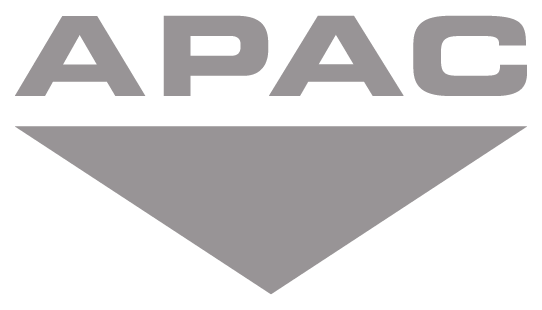
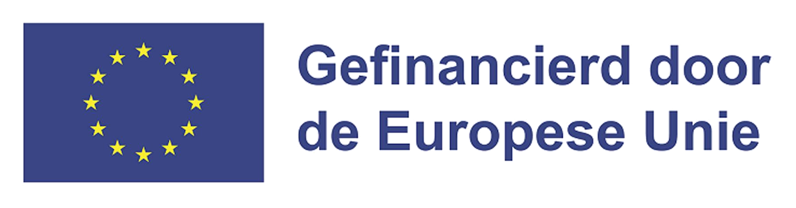
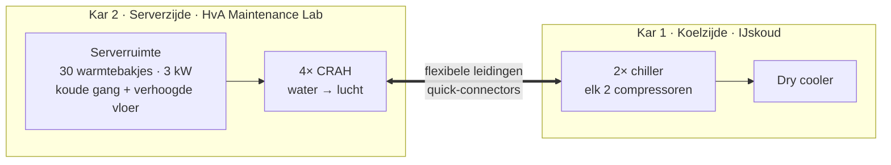
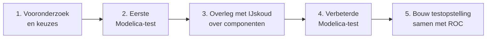

  <picture><source media="(prefers-color-scheme: dark)" srcset="docs/img/logos/lucend-wit.svg"></picture>&nbsp;&nbsp;&nbsp;&nbsp;
  <picture><source media="(prefers-color-scheme: dark)" srcset="docs/img/logos/hva-wit.png"></picture>&nbsp;&nbsp;&nbsp;&nbsp;
  &nbsp;&nbsp;&nbsp;&nbsp;
  &nbsp;&nbsp;&nbsp;&nbsp;
  

  &nbsp;&nbsp;&nbsp;&nbsp;
  

# DELTA – fysieke datacenter-testopstelling

Een klein, fysiek datacenter in het HvA Maintenance Lab. Met deze testopstelling verzamelen we data die je in een draaiend datacenter niet veilig of praktisch kunt verzamelen: grenssituaties, storingen en het gedrag van de koelzijde (chillers, dry coolers, waterlopen). Die data gebruiken we voor de AI-modellen en digital twins binnen project DELTA.

> DELTA is een samenwerking tussen Lucend (penvoerder) en de Hogeschool van Amsterdam, medegefinancierd door de Europese Unie via EFRO / Kansen voor West III.

## Inhoud

- [Waarom deze opstelling](#waarom-deze-opstelling)
- [Wat we bouwen](#wat-we-bouwen)
- [Wie doet wat](#wie-doet-wat)
- [Aanpak in stappen](#aanpak-in-stappen)
- [Storingen en scenario's die de opstelling moet kunnen simuleren](#storingen-en-scenarios-die-de-opstelling-moet-kunnen-simuleren)
- [Planning](#planning)
- [Documentatie in deze repo](#documentatie-in-deze-repo)

## Waarom deze opstelling

- Datacenters gebruiken veel en steeds meer stroom.
- Contracten sturen op beschikbaarheid (uptime), niet op duurzaamheid. Koeling wordt daardoor ruim en voorzichtig afgesteld.
- Lucend optimaliseert datacenters, maar heeft geen inzicht in een deel van de data, zoals de data aan de kant van de chillers. En dingen uitproberen kan in een draaiend datacenter niet.

De testopstelling is een veilige proeftuin: hier kunnen we wél variëren, storingen veroorzaken en meten.

## Wat we bouwen

De opstelling bestaat uit twee losse, verrijdbare karren die met flexibele leidingen en zelfsluitende quick-connectors aan elkaar gekoppeld worden. Zo kan de koelkar bijvoorbeeld in een klimaatkamer staan, met de leidingen naar buiten naar de serverkar.

**Kar 1 – koelzijde (IJskoud)**
- Koelcapaciteit ca. 2,8 kW.
- 2 chillers met elk 2 compressoren, voor 4 CRAH's op de serverkar.
- Dubbele waterloop, zodat de kar ook dry cooling kan doen.
- De regelaars voor de koelzijde komen van APAC.

**Kar 2 – serverzijde (gebouwd door het HvA Maintenance Lab met ROC-studenten)**
- Warmtelast tot 3 kW in 30 "warmtebakjes" van 100 W, terug te regelen met PWM. Elk bakje is een nepserver: een NiCr-weerstandsstrip met twee ventilatoren.
- Een serverruimte als "box in een box": een binnenbox met twee rekken en een koude gang in het midden, met koude lucht via een verhoogde vloer. Daaromheen de "kamer" met in elke hoek een CRAH.
- Schakelkast met 3 voedingen (Mean Well SDR-960-48), elk voor een groep van 10 bakjes.

Alle vastgelegde eisen en keuzes staan in het [Programma van Eisen](docs/PvE.md).

## Wie doet wat

| Partij | Rol |
|---|---|
| Lucend | Penvoerder van DELTA. Modelica-simulaties van de testopstelling; AI-modellen en optimalisatie van datacenters |
| Hogeschool van Amsterdam – Maintenance Lab | Bouw van de fysieke testopstelling, aansturing van en communicatie met IJskoud |
| IJskoud | Ontwerp, componentkeuze en bouw van de koelzijde (kar 1) |
| ROC van Amsterdam | MBO-studenten tekenen en bouwen delen van de serverkar (zie hieronder) |
| APAC | Levert de regelaars voor de koelzijde |

De serverzijde is voor de ROC-studenten opgedeeld in vier deelopdrachten:

1. Ontwerp en bouw van de verrijdbare kar (na een lascursus bij de HvA lassen de studenten de kar zelf)
2. Warmtelastmodule: de regelbare "nepserver" (warmtebakje)
3. Serverruimte met verhoogde vloer en transparante buitenkant
4. CRAH-module: van koud water naar koude lucht

## Aanpak in stappen

**1. Vooronderzoek en keuzes**
Use cases en wensen opgehaald bij datacenters, engineers en Lucend (interviews en de workshop met engineers). Daaruit volgen de componenten die de opstelling moet hebben en de storingen die hij moet kunnen simuleren.

**2. Eerste Modelica-test**
Lucend maakt een Modelica-simulatie van de hele opstelling: werkt het concept, en hoe goed schaalt een datacenter-koelsysteem naar een opstelling van een paar kW?

**3. Overleg met IJskoud over componenten**
De HvA stemt met IJskoud af; IJskoud kiest de componenten voor de koelzijde. Door de beschikbare (relatief grote) compressoren en chillers komt de koelcapaciteit uit op ca. 2,8 kW. Daarop is de warmtelast van de serverkar opgeschaald naar 3 kW.

**4. Verbeterde Modelica-test**
Lucend draait de simulatie opnieuw, nu met de componenten van IJskoud en de werkelijke opbouw van de serverkar.

**5. Bouw van de testopstelling samen met ROC**
De serverkar wordt in fasen gebouwd, zodat er vroeg al gemeten kan worden:

| Fase | Bakjes | Warmtelast | Voedingen |
|---|---|---|---|
| 1 | 10 | 1 kW | 1× SDR-960-48 |
| 2 | 20 | 2 kW | 2× SDR-960-48 |
| 3 | 30 | 3 kW | 3× SDR-960-48 |

Fase 1 is geen wegwerpopstelling: alles wat lastig te vervangen is (kast, kabelgoten, DIN-rail, doorvoeren, werkschakelaar) is meteen gedimensioneerd op fase 3.

## Storingen en scenario's die de opstelling moet kunnen simuleren

De opstelling is bedoeld om situaties na te bootsen die in een echt datacenter voorkomen maar daar niet veilig te testen zijn:

| Scenario | Wat we variëren of simuleren |
|---|---|
| Temperatuur waterloop | De watertemperatuur in de loop aanpassen |
| Defecte waterklep bij een CRAH | Een klepfout bij een CRAH simuleren |
| Type klep in de CRAH | Modulerende (variabele) klep in plaats van open/dicht |
| Pendelende dry cooler | Onderzoeken waarom een dry cooler soms pendelt |
| Vervuilde luchtfilters dry cooler | Filters van de dry cooler |
| Vervuilde filters in de waterloop | Filters in de gekoelde waterloop |
| Floor tiles | Vloertegels van de verhoogde vloer open of dicht |
| Wisselende chillercapaciteit | De capaciteit van een chiller laten wisselen |
| Warmtelast | De serverbelasting per bakje regelen met PWM (0–100 W per bakje) |

Daarnaast is er een analysedoel: **chiller-setpoints herkennen uit andere data**, voor alle gevallen waarin de fabrikant de setpoints niet deelt.

Omdat er meerdere chillers, meerdere compressoren per chiller en meerdere CRAH's zijn, kunnen we ook verschillende configuraties van echte datacenters nabootsen.

## Planning

| Wanneer (beoogd) | Mijlpaal |
|---|---|
| 10 december 2026 | Workshop "LLM's inzetten voor het maken van Modelica-simulaties" |
| Eind december 2026 | Eerste 10 bakjes klaar (1 kW) |
| Eind Q1 2027 | Volledige serverkar (30 bakjes, 3 kW) |

## Documentatie in deze repo

Zie ook het [overzicht van de hardwaremappen](hardware/).

**Status:** ✅ staat in de repo · 🟡 deels aanwezig · ⬜ nog onbekend / niet aangeleverd

| Document | Kar | Map | Aangeleverd door | Status | Bijgewerkt |
|---|---|---|---|---|---|
| Programma van Eisen (v0.2) | beide | [docs/PvE.md](docs/PvE.md) | HvA | ✅ | 27-11-2026 |
| Stuklijst (BOM) fase 1 | serverkar | [hardware/serverkar/bom](hardware/serverkar/bom/) | HvA | ✅ | 27-11-2026 |
| Elektrische schema's (blad 1, 2, 3, 6 + bijlage) | serverkar | [hardware/serverkar/elektrisch](hardware/serverkar/elektrisch/) | HvA | ✅ | 27-11-2026 |
| Mechanische tekeningen (blad 4, 5, 7) | serverkar | [hardware/serverkar/mechanisch](hardware/serverkar/mechanisch/) | HvA | ✅ | 27-11-2026 |
| Stuklijst (BOM) | koelkar | [hardware/koelkar/bom](hardware/koelkar/bom/) | IJskoud | ⬜ | – |
| Technische schema's (P&ID) | koelkar | [hardware/koelkar/technisch](hardware/koelkar/technisch/) | IJskoud | ⬜ | – |
| Elektrische schema's | koelkar | [hardware/koelkar/elektrisch](hardware/koelkar/elektrisch/) | IJskoud | ⬜ | – |
| Stuklijst stalen frames | beide | [hardware/karren-frame/bom](hardware/karren-frame/bom/) | HvA / ROC | ⬜ | – |
| Ontwerp en tekeningen frames (serverkar: DATACENTER CAR) | beide | [hardware/karren-frame/tekeningen](hardware/karren-frame/tekeningen/) | HvA / ROC | 🟡 | 27-11-2026 |
| Modelica-modellen | beide | [modelica/](modelica/) | Lucend | ⬜ | – |
| Logo's partners | – | [docs/img/logos/](docs/img/logos/) | HvA | ✅ | 27-11-2026 |

> Zet de status op ✅ (of 🟡) en vul de datum in zodra er een document in de map staat. Een map met alleen een README telt als ⬜.

## Veiligheid

De netzijde van de serverkar wordt aangesloten en gekeurd door een bevoegd persoon (NEN 3140). Werk niet aan de schakelkast als de kar onder spanning staat.

## Contact

Projectleider HvA: a.van.schravendijk@hva.nl
