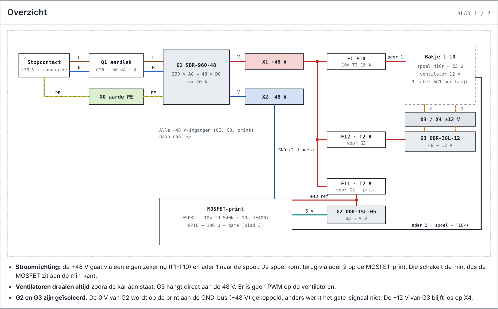
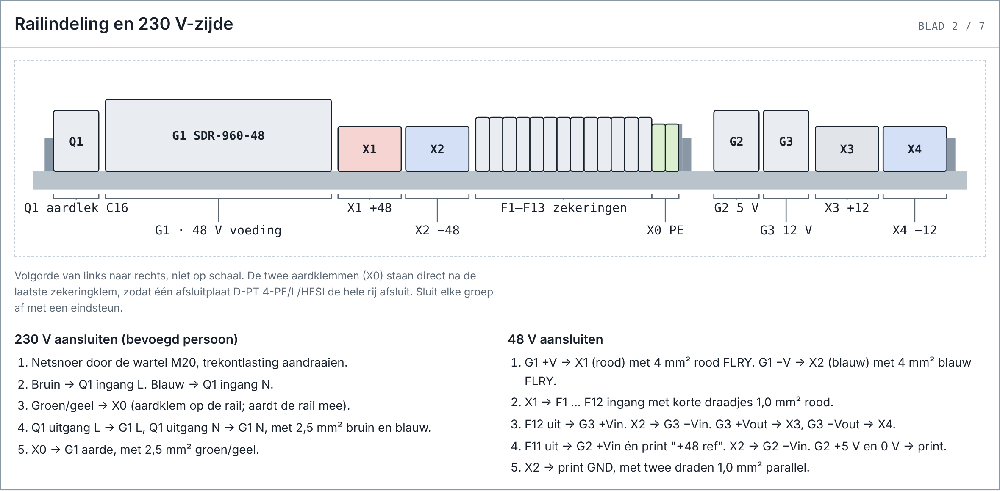
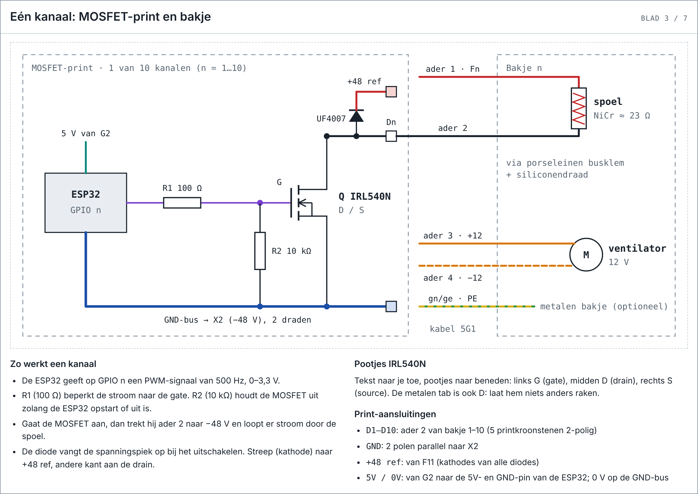
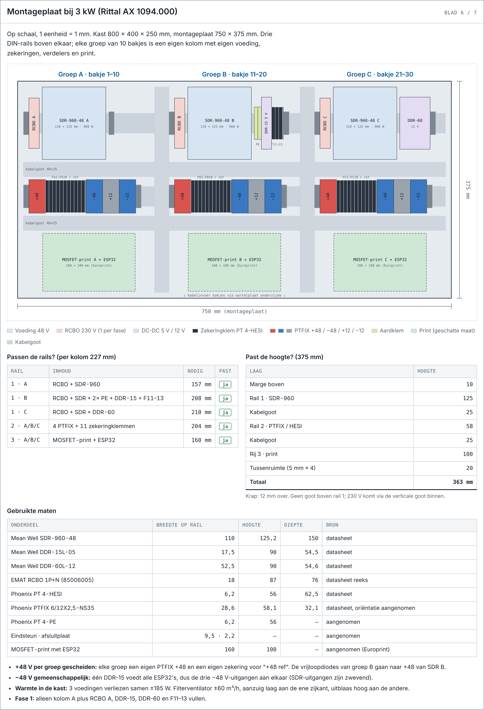
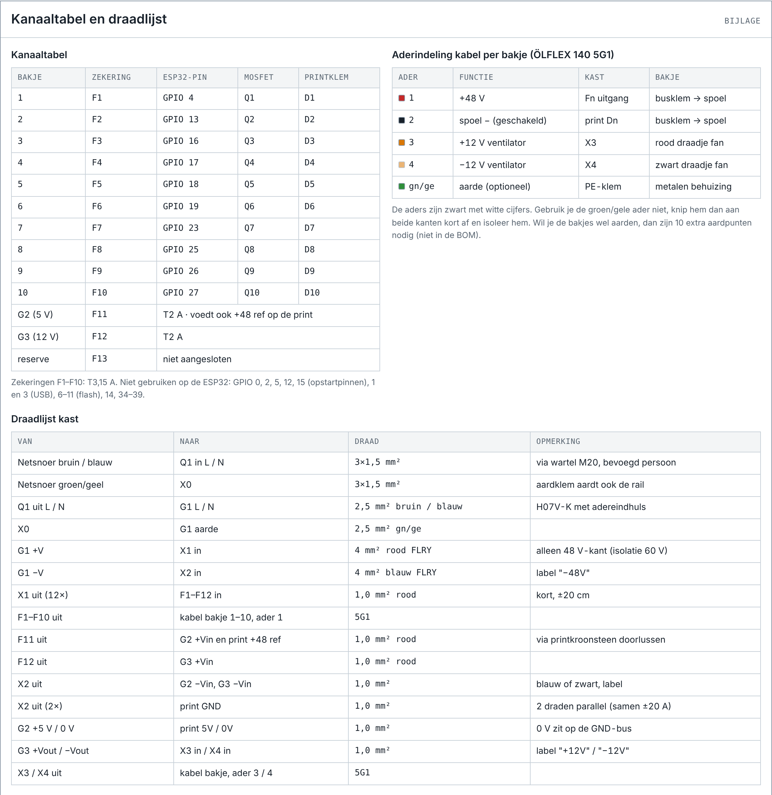

# Serverkar – elektrische schema's

[← terug naar de README](../../../README.md) · [Programma van Eisen](../../../docs/PvE.md#4-serverkar--elektrisch) · [Mechanische tekeningen](../mechanisch/)

Alle bladen samen als PDF: [elektrisch-serverkar.pdf](elektrisch-serverkar.pdf). De bron van alle tekeningen is [tekeningen-serverkar-bron.html](../tekeningen-serverkar-bron.html) (openen in een browser).

> Blad 1 t/m 3 en de bijlage tonen één groep van 10 bakjes (fase 1, één SDR-960-48). Blad 6 toont de montageplaat bij 3 kW (3 groepen).

| Blad | Inhoud |
|---|---|
| 1 | [Overzicht](#blad-1--overzicht): van stopcontact tot bakje |
| 2 | [Railindeling en 230 V-zijde](#blad-2--railindeling-en-230-v-zijde) |
| 3 | [Eén kanaal: MOSFET-print en bakje](#blad-3--één-kanaal-mosfet-print-en-bakje) |
| 6 | [Montageplaat bij 3 kW (Rittal AX 1094.000)](#blad-6--montageplaat-bij-3-kw) |
| Bijlage | [Kanaaltabel en draadlijst](#bijlage--kanaaltabel-en-draadlijst) |

Blad 4, 5 en 7 staan bij de [mechanische tekeningen](../mechanisch/).

## Blad 1 – Overzicht

## Blad 2 – Railindeling en 230 V-zijde

## Blad 3 – Eén kanaal: MOSFET-print en bakje

## Blad 6 – Montageplaat bij 3 kW

## Bijlage – Kanaaltabel en draadlijst

