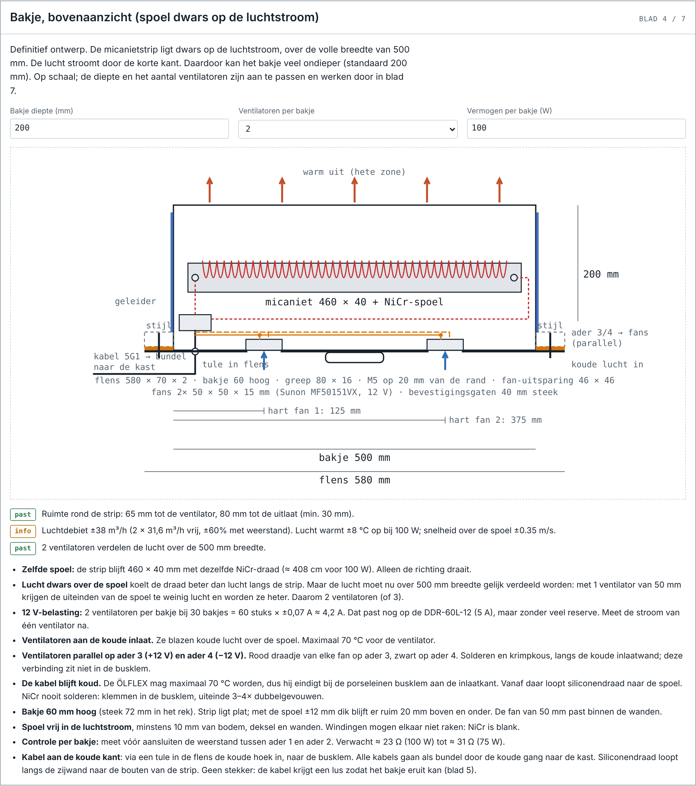
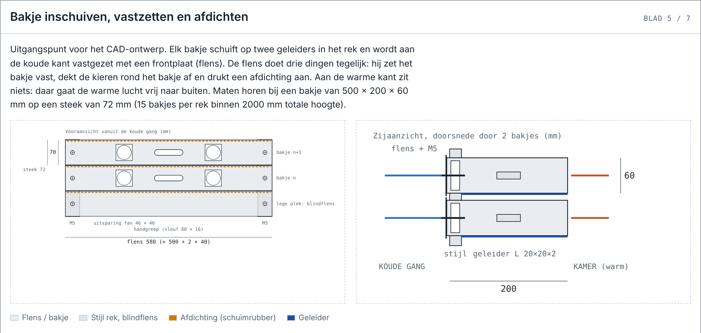
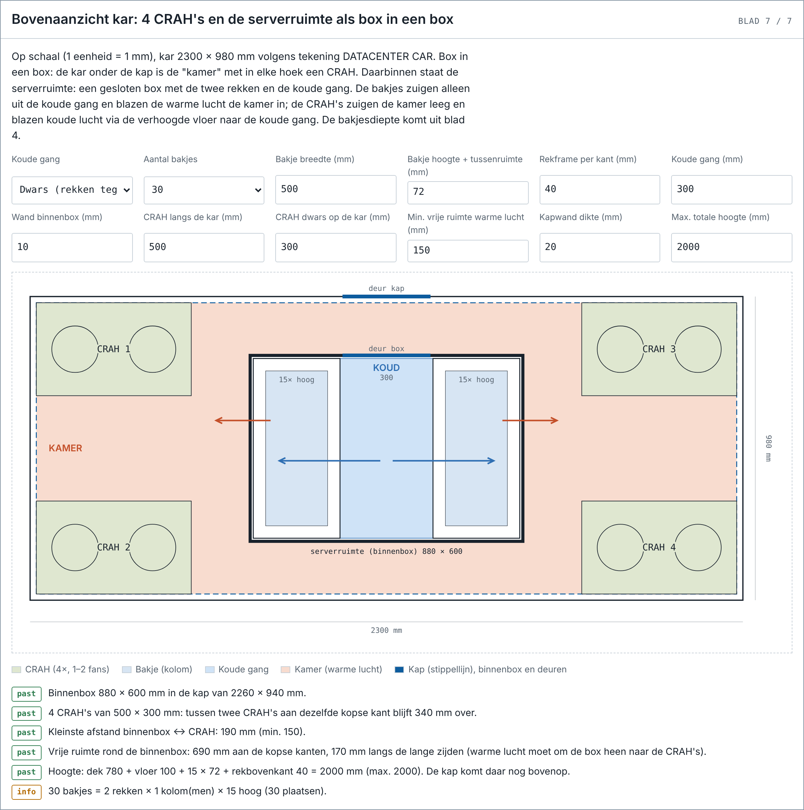

# Serverkar – mechanische tekeningen

[← terug naar de README](../../../README.md) · [Programma van Eisen](../../../docs/PvE.md#3-serverkar-kar-2--mechanisch) · [Elektrische schema's](../elektrisch/)

De bron van alle tekeningen is [tekeningen-serverkar-bron.html](../tekeningen-serverkar-bron.html). Open die in een browser: op blad 7 kun je de maten aanpassen en rekent de tekening opnieuw uit of alles past.

| Blad | Inhoud |
|---|---|
| 4 | [Bakje, bovenaanzicht](#blad-4--bakje-bovenaanzicht) (spoel dwars op de luchtstroom) |
| 5 | [Bakje inschuiven, vastzetten en afdichten](#blad-5--bakje-inschuiven-vastzetten-en-afdichten) |
| 7 | [Bovenaanzicht kar](#blad-7--bovenaanzicht-kar): 4 CRAH's en de serverruimte als box in een box |

De CAD-bestanden van het bakje staan [hieronder](#cad-bestanden-bakje). Het frame van de kar zelf staat bij [karren-frame/tekeningen](../../karren-frame/tekeningen/).

## CAD-bestanden (bakje)

| Bestand | Inhoud | Eenheid |
|---|---|---|
| [bakje.stp](bakje.stp) | 3D-model (STEP) van het samengestelde bakje "alles samen": onderdelen *Bakje*, *boven plaat* en *voor plaat* (auteur: vince, 12-11-2026) | – |
| [bakje dxf.dxf](bakje%20dxf.dxf) | 2D-tekening bakje, ca. 693 × 299 | mm |
| [boven plaat dxf.dxf](boven%20plaat%20dxf.dxf) | 2D-tekening bovenplaat, ca. 21,7 × 8,7 | **inch** (≈ 551 × 221 mm) |
| [voor plaat dxf.dxf](voor%20plaat%20dxf.dxf) | 2D-tekening voorplaat, ca. 90 × 640 | mm |

> Let op: de DXF van de bovenplaat staat in inch, de andere twee in mm. Controleer de eenheid voordat je hem naar de lasersnijder of kantbank stuurt.

## Blad 4 – Bakje, bovenaanzicht

## Blad 5 – Bakje inschuiven, vastzetten en afdichten

## Blad 7 – Bovenaanzicht kar
Getekend met de standaardwaarden (30 bakjes, koude gang 300 mm). De aangenomen maten staan in het [PvE onder open punten](../../../docs/PvE.md#aannames-en-open-punten).

